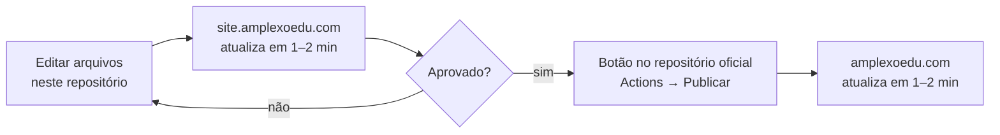

# Amplexo Educação — Site de teste

**https://site.amplexoedu.com**

Este repositório é o **ambiente de teste** do site da Amplexo Educação. Tudo o que vai para o site oficial passa por aqui primeiro: a equipe vê a mudança no ar em `site.amplexoedu.com`, aprova e só então publica em `amplexoedu.com`.

> [!IMPORTANT]
> Este **não** é o site oficial. O site oficial está em [amplexoedu/amplexoedu.com](https://github.com/amplexoedu/amplexoedu.com).

| Ambiente | Endereço | Repositório |
|---|---|---|
| Teste | https://site.amplexoedu.com | `amplexoedu/site-teste` (este) |
| Oficial | https://amplexoedu.com | [`amplexoedu/amplexoedu.com`](https://github.com/amplexoedu/amplexoedu.com) |

## Como funciona



1. **Edite** os arquivos deste repositório (direto no GitHub ou clonando e enviando com `git push`).
2. **Confira** em https://site.amplexoedu.com. Cada envio para o branch `main` atualiza o site de teste em 1 a 2 minutos.
3. **Publique** no site oficial pelo botão descrito abaixo.

## Publicar no site oficial

1. Abra [amplexoedu/amplexoedu.com → Actions → **Publicar site de teste no oficial**](https://github.com/amplexoedu/amplexoedu.com/actions/workflows/publicar-site-teste.yml).
2. Clique em **Run workflow**.
3. Em **O que levar**, informe os arquivos ou pastas separados por espaço:
   - para levar **tudo o que está em teste** (nova home, três idiomas, páginas legais, fontes locais), digite apenas `.`;
   - o valor que vem preenchido (`index.html css/home-v2.css js/home-v2.js assets/images/v2`) é da primeira versão do teste e **não basta mais**: a home agora depende das fontes locais, do seletor de idiomas e das páginas legais.
4. Em **Confirmação**, digite `PUBLICAR` e clique em **Run workflow**.

O resumo da execução lista os arquivos alterados, e o site oficial atualiza em 1 a 2 minutos.

Antes de publicar, tenha em mente:
- **O teste substitui o oficial.** Se alguém editou no repositório oficial um arquivo que também está aqui, a versão do teste prevalece.
- **O botão não apaga nada.** Ele só adiciona e atualiza. Um arquivo removido daqui continua existindo no oficial até ser apagado lá.

## Arquivos exclusivos do teste

Estes arquivos são a configuração do ambiente de teste. O botão de publicação **nunca** os leva para o oficial:

| Arquivo | Aqui | No oficial |
|---|---|---|
| `CNAME` | `site.amplexoedu.com` | `amplexoedu.com` |
| `robots.txt` | bloqueia buscadores | não existe |
| `README.md` | esta documentação | documentação do site oficial |

> [!CAUTION]
> Nunca copie `CNAME` ou `robots.txt` para o repositório oficial: isso tiraria `amplexoedu.com` do ar e do Google.

A página inicial também evita indexação por conta própria: quando é aberta em `site.amplexoedu.com`, adiciona `noindex` automaticamente. Em `amplexoedu.com`, essa linha não faz nada. Assim o mesmo `index.html` serve para os dois ambientes, sem precisar de ajuste na hora de publicar.

## Em teste agora: nova identidade visual na página inicial

A página inicial (`/`, `/en/`, `/es/`) usa a identidade do **kit de marca Amplexo** (manual v1.0, novembro de 2026), **sem mudar o resto do site**. Layout, fundos, tamanhos, efeitos e textos são os mesmos da versão anterior. Assim dá para comparar só a marca nova com a antiga. As outras páginas continuam com a identidade anterior.

| Arquivo | Conteúdo |
|---|---|
| `css/home-reference.css` | O mesmo arquivo de antes, só com as cores e a fonte do kit |
| `css/fonts.css` | Ganhou a **Lexend** (fonte institucional), em cinco pesos |
| `assets/fonts/lexend-*.woff2` | A Lexend convertida para a web, hospedada no próprio site (sem Google Fonts) |
| `assets/brand/` | Arquivos oficiais do kit: marca positiva (com e sem descritor), favicon, ícones de aplicativo, manifesto e imagem de compartilhamento |
| `favicon.ico` | Favicon na raiz, onde os navegadores procuram por padrão |
| `index.html`, `en/index.html`, `es/index.html` | Marca nova no cabeçalho, favicon, cor do navegador (`#1E2B4E`) e imagem de compartilhamento (Open Graph) |

O que mudou:
- **Marca:** a versão positiva oficial (para fundo claro) no cabeçalho, com 240 px de largura (o mínimo do manual é 200 px). Em telas com menos de 360 px entra a versão sem descritor.
- **Cores:** cada cor antiga virou a equivalente do kit. Azul-marinho virou azul `#1E2B4E`; vinho virou vermelho `#651D2F`; âmbar virou ouro `#CB9510`. O bege do fundo virou branco (o manual pede branco puro), o creme dos cartões de contato virou ouro a 10% e os rosados viraram vermelho a 10%. O verde-água, que não existe no kit, virou vermelho no sobretítulo "Propósito" e ouro na linha acima dos números.
  O kit também tem um "vermelho para telas" (`#7A1428`, pasta 03), mas ele vale só para as imagens de redes sociais. O site usa o `#651D2F`, o mesmo do favicon, dos logos e do `cores.css` do kit.
- **Fonte:** Lexend no lugar da Spectral (títulos) e da Asap (textos), nos mesmos tamanhos. A Lexend é mais larga, então alguns títulos quebram em mais linhas. Ela não tem itálico, por isso a citação do prêmio ficou sem itálico.
- **Favicon, ícones de aplicativo, cor do navegador e imagem de compartilhamento** do kit (pasta 04).

Os elementos gráficos do kit (padrão de L, moldura em L, faixa dourada e ícones de apoio) ficaram de fora de propósito, porque o site antigo não tinha nada parecido. Eles podem entrar depois, um de cada vez.

A imagem de compartilhamento aponta para `https://amplexoedu.com/assets/brand/...`: no WhatsApp e nas redes ela só aparece depois de publicada no oficial.

> [!NOTE]
> A pasta `Amplexo - Kit de marca/` é o material de origem (manual, EPS, PDFs para gráfica) e fica no Drive da equipe. Ela está no `.gitignore`: mesmo que alguém a coloque na pasta do repositório, ela não é enviada ao GitHub. Este repositório é público, e o que entra nele fica no histórico para sempre, mesmo se for apagado depois. O site usa apenas as cópias em `assets/brand/`, `assets/fonts/` e `favicon.ico`. Quando o kit mudar, copie para lá só os arquivos que o site usa.

Para publicar no oficial, use em **O que levar**: `index.html en/index.html es/index.html css/home-reference.css css/fonts.css assets/fonts assets/brand favicon.ico`.

## Em teste agora: Matrículas e rematrículas 2027

**https://site.amplexoedu.com/matriculas/** (no oficial: `amplexoedu.com/matriculas/`)

| Arquivo | Conteúdo |
|---|---|
| `matriculas/index.html` | Página da campanha em português |
| `en/matriculas/index.html`, `es/matriculas/index.html` | A mesma página em inglês e em espanhol |
| `css/matriculas.css` | Estilos da página |
| `js/matriculas.js` | Menu do celular, cabeçalho e revelação suave ao rolar |

As fotos e o selo Brands For Good já existem no site. A marca e a fonte do kit de marca estão em `assets/brand/`, `assets/fonts/` e `css/fonts.css`.

Para publicar no oficial, use em **O que levar**: `matriculas en/matriculas es/matriculas css/matriculas.css css/global.css css/fonts.css js/matriculas.js js/global.js js/cookies.js assets/fonts assets/brand favicon.ico` (ou `.` para levar tudo o que está em teste).

**Identidade do kit de marca.** Como na página inicial, só a identidade mudou. Layout, fundos, efeitos e textos são os da versão anterior, para comparar:
- **Cores:** os vários tons de azul, vinho, marsala e dourado viraram o tom único do kit (azul `#1E2B4E`, vermelho `#651D2F`, ouro `#CB9510`); os degradês dourados viraram ouro liso; o bege do fundo virou branco e o creme virou ouro a 10%. Onde o manual não permite a combinação, a cor foi ajustada: os dourados sobre fundo claro viraram vermelho, os ícones das trilhas sobre fundo claro ficaram azuis e cinco textos dourados pequenos sobre vermelho ficaram brancos.
- **Fonte:** Lexend no lugar da Spectral e da Asap, nos mesmos tamanhos, e sem itálico, porque a Lexend não tem itálico.
- **Marca no cabeçalho:** versão positiva com descritor acima de 680 px (200 px, o mínimo do manual) e sem descritor entre 521 e 680 px. Nos celulares (até 520 px), a barra também tem o botão do WhatsApp, as bandeiras e o menu, e não sobra espaço para a marca no tamanho mínimo; ali entra o ícone reduzido, no mesmo lugar do logo pequeno de antes.
- **Cabeçalho:** como a marca nova e a Lexend são mais largas, as etapas que já existiam acontecem um pouco antes: as bandeiras perdem os nomes a partir de 1320 px (antes, 1280 px) e o botão vira só o ícone do WhatsApp a partir de 1240 px (antes, 1100 px). O espaço entre os itens do menu passou de 14 para 12 px.
- **Rodapé:** o ícone vermelho antigo virou o ícone de aplicativo do kit. **Favicon** e **cor do navegador** também vêm do kit. A imagem de compartilhamento (foto dos alunos) não mudou.

Seções: abertura com a faixa da campanha · o clube · trilhas · como funciona · comunidade · olimpíadas · conquistas · recursos e horários · campanha e chegada · dúvidas · convite final. Todos os botões abrem o WhatsApp (11) 91100-9793 com uma de três mensagens prontas: nova matrícula, rematrícula ou valores e condições. A página não mostra preços. Assim como a página inicial, ela adiciona `noindex` sozinha quando aberta em `site.amplexoedu.com`.

## Em teste agora: nova página inicial

| Arquivo | Conteúdo |
|---|---|
| `index.html` | Nova página inicial |
| `css/home-v2.css` | Estilos da nova página (a anterior usava `css/home-reference.css`) |
| `js/home-v2.js` | Animações e interações |
| `assets/images/v2/` | Fotos otimizadas em WebP |

Seções da página: abertura com parede de fotos em movimento · faixas cruzadas com as atividades · números (famílias, premiações, 1º lugar, Brands For Good) · propósito com texto que acende ao rolar · foto que se expande ("Abrace e seja abraçado pela Educação") · ambientes de aprendizagem em cartões empilhados · prêmio Brands For Good Awards 2026 · contatos.

A página respeita a configuração de **movimento reduzido** do sistema: quem desativa animações vê tudo sem efeitos.

As demais páginas (Jornal Amplexo, Escola Azul, Premiações, Competições, ACSL etc.) vêm do site oficial, agora em três idiomas.

## Em teste agora: português, inglês e espanhol

Todas as páginas existem em três idiomas, com o mesmo caminho em cada pasta:

| Idioma | Onde fica | Exemplo |
|---|---|---|
| Português | raiz | `/premiacoes/` |
| Inglês | `en/` | `/en/premiacoes/` |
| Espanhol | `es/` | `/es/premiacoes/` |

As páginas legais são a exceção: têm o endereço traduzido (`/privacidade/`, `/en/privacy/`, `/es/privacidad/`).

> [!IMPORTANT]
> A **página inicial** e **Matrículas** em inglês e espanhol são traduções da versão em português, com a mesma estrutura. Ao mudar um texto em português, mude também em `en/` e `es/`; senão, as versões ficam diferentes.

**Como o idioma é escolhido** (`js/global.js`):
1. Na primeira visita, o site usa o idioma do navegador. Português e espanhol vão para as versões respectivas; qualquer outro idioma vai para o inglês.
2. Quando a pessoa escolhe um idioma pelas bandeiras, a escolha fica guardada no navegador e passa a valer em todas as páginas.
3. Robôs de busca (Google, Bing) não são redirecionados, para que as três versões apareçam nas buscas. As tags `hreflang` indicam a eles qual página corresponde a qual idioma.

**Para criar ou alterar uma página**, edite o HTML normalmente e depois rode, na raiz do repositório:

```bash
node scripts/idiomas.js
```

O script aplica em todas as páginas o seletor de bandeiras, as tags `hreflang`, as fontes locais, a capa dos vídeos do YouTube e o aviso de cookies (`js/cookies.js`). Para uma página nova, acrescente antes os três caminhos dela na lista `PAGINAS`, no início do script. Página fora dessa lista (como `matriculas/`)? Coloque à mão, antes do `</head>`: `<script src="../js/cookies.js" defer></script>` (ajuste os `../` à profundidade da pasta).

## Em teste agora: privacidade, termos e acessibilidade

| Documento | Português | Inglês | Espanhol |
|---|---|---|---|
| Política de Privacidade | `/privacidade/` | `/en/privacy/` | `/es/privacidad/` |
| Termos de Uso | `/termos/` | `/en/terms/` | `/es/terminos/` |
| Declaração de Acessibilidade | `/acessibilidade/` | `/en/accessibility/` | `/es/accesibilidad/` |

Os textos consideram a LGPD (Brasil), as leis de proteção de dados de outros países da América do Sul, o GDPR (União Europeia) e as leis dos Estados Unidos (COPPA, CCPA/CPRA), além das WCAG 2.2, da Lei Brasileira de Inclusão, do ADA e do Ato Europeu de Acessibilidade. Dados que a empresa ainda precisa informar (razão social, endereço, encarregado de dados, foro) aparecem **destacados em amarelo** nas páginas.

> [!WARNING]
> Os documentos legais devem ser revisados por um(a) advogado(a) antes de serem publicados no site oficial.

Para que o site cumpra o que esses documentos dizem:
- **Cookies só com consentimento.** O único rastreador é o Pixel da Meta, que só carrega depois do "Aceitar" no aviso de cookies (veja a seção abaixo). O site não usa analytics.
- **Fontes no próprio site** (`assets/fonts/`, `css/fonts.css`). Abrir uma página não envia o IP do visitante ao Google.
- **Vídeos do YouTube só carregam ao clicar.** Até lá aparece uma capa guardada no site (`assets/images/youtube/`); depois do clique, o vídeo abre no modo de privacidade aprimorada (`youtube-nocookie.com`).

Se um dia o site passar a usar analytics ou outro serviço que colete dados, a Política de Privacidade precisa ser atualizada e o serviço deve carregar só depois do consentimento, como o Pixel.

## Em teste agora: Pixel da Meta e aviso de cookies

O site tem o **Pixel da Meta** (Facebook e Instagram), ID `1873573433803022`, para medir os anúncios e mostrá-los a quem visitou o site. Tudo fica em `js/cookies.js`, carregado em todas as páginas:

| Situação | O que acontece |
|---|---|
| Primeira visita | Aparece um cartão no pé da tela ("Ajude o Amplexo a chegar a mais famílias"), com **Recusar** e **Aceitar** no mesmo destaque. Nada vai para a Meta. |
| Clicou em **Aceitar** | O Pixel carrega e registra a visita (`PageView`). Cada clique num botão do WhatsApp (`wa.me`) vira um **contato** (`Contact`). |
| Clicou em **Recusar** | O Pixel não carrega. Se tinha aceitado antes, os cookies do Pixel são apagados. |
| Visitas seguintes | A resposta fica guardada no navegador por 12 meses; depois, o aviso aparece de novo. |
| Mudar de ideia | Botão **Mudar minhas preferências de cookies** no item 12 da Política de Privacidade. |
| Navegador com *Global Privacy Control* | O aviso não aparece e o Pixel nunca carrega. |

> [!NOTE]
> O Pixel só funciona em **amplexoedu.com**. Em `site.amplexoedu.com` o aviso aparece normalmente, mas o Pixel não carrega, para que as visitas de teste não entrem nos números dos anúncios. Para conferir se o Pixel está funcionando no site oficial, use **Testar eventos** no Gerenciador de Eventos da Meta.

A **verificação do domínio** na Meta usa a etiqueta `<meta name="facebook-domain-verification" ...>` no `<head>` da página inicial (`index.html`). Ela não coleta dados e só vale depois de publicada em `amplexoedu.com`; não a remova, ou a Meta deixa de considerar o domínio verificado.

A Política de Privacidade (nos três idiomas) descreve o Pixel nos itens 3.3, 4, 7, 9, 10 e 12. Se o uso mudar (outro evento, outro pixel, outra rede), atualize a política junto.

Para publicar no oficial, use em **O que levar**: `.` (as 47 páginas receberam o script, e as três políticas e `css/legal.css` mudaram).

## Ver no computador

Com o [Node.js](https://nodejs.org/) instalado, na pasta do repositório:

```bash
npx http-server . -p 4173 -c-1
```

Abra http://127.0.0.1:4173.

## Trazer novidades do site oficial

Se o site oficial receber mudanças feitas direto nele, traga-as para cá antes de publicar, para o teste não sobrescrevê-las:

```bash
git remote add oficial https://github.com/amplexoedu/amplexoedu.com.git   # só na primeira vez
git fetch oficial
git merge oficial/main
git push origin main
```

Depois do merge, confira se o `CNAME` continua `site.amplexoedu.com`. Se o Git apontar conflito no `README.md`, mantenha a versão deste repositório.

## Configuração do ambiente

Normalmente não é preciso mexer nisto. Fica registrado para referência:

- **DNS (Hostinger):** registro `CNAME`, nome `site`, apontando para `amplexoedu.github.io`.
- **GitHub Pages (este repositório):** *Settings → Pages* → *Deploy from a branch* → `main` / `(root)`, *Custom domain* `site.amplexoedu.com`, *Enforce HTTPS* ligado.
- **Botão de publicação:** [`.github/workflows/publicar-site-teste.yml`](https://github.com/amplexoedu/amplexoedu.com/blob/main/.github/workflows/publicar-site-teste.yml), no repositório oficial.

## Licença

Uso restrito. Veja [LICENSE](LICENSE).
