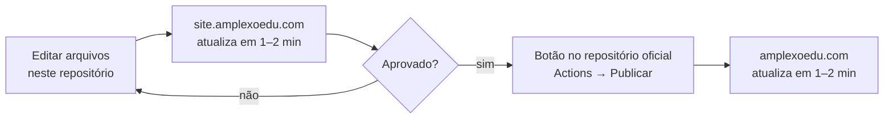

# Amplexo Educação — Site de teste

**https://site.amplexoedu.com**

Este repositório é o **ambiente de teste** do site da Amplexo Educação. Tudo o que vai para o site oficial passa por aqui primeiro: a equipe vê a mudança no ar em `site.amplexoedu.com`, aprova e só então publica em `amplexoedu.com`.

> [!IMPORTANT]
> Este **não** é o site oficial. O site oficial está em [amplexoedu/amplexoedu.com](https://github.com/amplexoedu/amplexoedu.com).

| Ambiente | Endereço | Repositório |
|---|---|---|
| Teste | https://site.amplexoedu.com | `amplexoedu/site-teste` (este) |
| Oficial | https://amplexoedu.com | [`amplexoedu/amplexoedu.com`](https://github.com/amplexoedu/amplexoedu.com) |

## Como funciona



1. **Edite** os arquivos deste repositório (direto no GitHub ou clonando e enviando com `git push`).
2. **Confira** em https://site.amplexoedu.com. Cada envio para o branch `main` atualiza o site de teste em 1 a 2 minutos.
3. **Publique** no site oficial pelo botão descrito abaixo.

## Publicar no site oficial

1. Abra [amplexoedu/amplexoedu.com → Actions → **Publicar site de teste no oficial**](https://github.com/amplexoedu/amplexoedu.com/actions/workflows/publicar-site-teste.yml).
2. Clique em **Run workflow**.
3. Em **O que levar**, informe os arquivos ou pastas separados por espaço:
   - para levar **tudo o que está em teste** (nova home, três idiomas, páginas legais, fontes locais), digite apenas `.`;
   - o valor que vem preenchido (`index.html css/home-v2.css js/home-v2.js assets/images/v2`) é da primeira versão do teste e **não basta mais**: a home agora depende das fontes locais, do seletor de idiomas e das páginas legais.
4. Em **Confirmação**, digite `PUBLICAR` e clique em **Run workflow**.

O resumo da execução lista os arquivos alterados, e o site oficial atualiza em 1 a 2 minutos.

Antes de publicar, tenha em mente:
- **O teste substitui o oficial.** Se alguém editou no repositório oficial um arquivo que também está aqui, a versão do teste prevalece.
- **O botão não apaga nada.** Ele só adiciona e atualiza. Um arquivo removido daqui continua existindo no oficial até ser apagado lá.

## Arquivos exclusivos do teste

Estes arquivos são a configuração do ambiente de teste. O botão de publicação **nunca** os leva para o oficial:

| Arquivo | Aqui | No oficial |
|---|---|---|
| `CNAME` | `site.amplexoedu.com` | `amplexoedu.com` |
| `robots.txt` | bloqueia buscadores | não existe |
| `README.md` | esta documentação | documentação do site oficial |

> [!CAUTION]
> Nunca copie `CNAME` ou `robots.txt` para o repositório oficial: isso tiraria `amplexoedu.com` do ar e do Google.

A página inicial também evita indexação por conta própria: quando é aberta em `site.amplexoedu.com`, adiciona `noindex` automaticamente. Em `amplexoedu.com`, essa linha não faz nada. Assim o mesmo `index.html` serve para os dois ambientes, sem precisar de ajuste na hora de publicar.

## Em teste agora: nova página inicial

| Arquivo | Conteúdo |
|---|---|
| `index.html` | Nova página inicial |
| `css/home-v2.css` | Estilos da nova página (a anterior usava `css/home-reference.css`) |
| `js/home-v2.js` | Animações e interações |
| `assets/images/v2/` | Fotos otimizadas em WebP |

Seções da página: abertura com parede de fotos em movimento · faixas cruzadas com as atividades · números (famílias, premiações, 1º lugar, Brands For Good) · propósito com texto que acende ao rolar · foto que se expande ("Abrace e seja abraçado pela Educação") · ambientes de aprendizagem em cartões empilhados · prêmio Brands For Good Awards 2026 · contatos.

A página respeita a configuração de **movimento reduzido** do sistema: quem desativa animações vê tudo sem efeitos.

As demais páginas (Jornal Amplexo, Escola Azul, Premiações, Competições, ACSL etc.) vêm do site oficial, agora em três idiomas.

## Em teste agora: português, inglês e espanhol

Todas as páginas existem em três idiomas, com o mesmo caminho em cada pasta:

| Idioma | Onde fica | Exemplo |
|---|---|---|
| Português | raiz | `/premiacoes/` |
| Inglês | `en/` | `/en/premiacoes/` |
| Espanhol | `es/` | `/es/premiacoes/` |

As páginas legais são a exceção: têm o endereço traduzido (`/privacidade/`, `/en/privacy/`, `/es/privacidad/`).

**Como o idioma é escolhido** (`js/global.js`):
1. Na primeira visita, o site usa o idioma do navegador. Português e espanhol vão para as versões respectivas; qualquer outro idioma vai para o inglês.
2. Quando a pessoa escolhe um idioma pelas bandeiras, a escolha fica guardada no navegador e passa a valer em todas as páginas.
3. Robôs de busca (Google, Bing) não são redirecionados, para que as três versões apareçam nas buscas. As tags `hreflang` indicam a eles qual página corresponde a qual idioma.

**Para criar ou alterar uma página**, edite o HTML normalmente e depois rode, na raiz do repositório:

```bash
node scripts/idiomas.js
```

O script aplica em todas as páginas o seletor de bandeiras, as tags `hreflang`, as fontes locais e a capa dos vídeos do YouTube. Para uma página nova, acrescente antes os três caminhos dela na lista `PAGINAS`, no início do script.

## Em teste agora: privacidade, termos e acessibilidade

| Documento | Português | Inglês | Espanhol |
|---|---|---|---|
| Política de Privacidade | `/privacidade/` | `/en/privacy/` | `/es/privacidad/` |
| Termos de Uso | `/termos/` | `/en/terms/` | `/es/terminos/` |
| Declaração de Acessibilidade | `/acessibilidade/` | `/en/accessibility/` | `/es/accesibilidad/` |

Os textos consideram a LGPD (Brasil), as leis de proteção de dados de outros países da América do Sul, o GDPR (União Europeia) e as leis dos Estados Unidos (COPPA, CCPA/CPRA), além das WCAG 2.2, da Lei Brasileira de Inclusão, do ADA e do Ato Europeu de Acessibilidade. Dados que a empresa ainda precisa informar (razão social, endereço, encarregado de dados, foro) aparecem **destacados em amarelo** nas páginas.

> [!WARNING]
> Os documentos legais devem ser revisados por um(a) advogado(a) antes de serem publicados no site oficial.

Para que o site cumpra o que esses documentos dizem:
- **Sem cookies e sem rastreadores.** O site não usa analytics, pixels nem publicidade. Por isso não precisa de banner de cookies.
- **Fontes no próprio site** (`assets/fonts/`, `css/fonts.css`). Abrir uma página não envia o IP do visitante ao Google.
- **Vídeos do YouTube só carregam ao clicar.** Até lá aparece uma capa guardada no site (`assets/images/youtube/`); depois do clique, o vídeo abre no modo de privacidade aprimorada (`youtube-nocookie.com`).

Se um dia o site passar a usar analytics, pixel ou outro serviço que colete dados, a Política de Privacidade precisa ser atualizada e um banner de consentimento passa a ser obrigatório na Europa.

## Ver no computador

Com o [Node.js](https://nodejs.org/) instalado, na pasta do repositório:

```bash
npx http-server . -p 4173 -c-1
```

Abra http://127.0.0.1:4173.

## Trazer novidades do site oficial

Se o site oficial receber mudanças feitas direto nele, traga-as para cá antes de publicar, para o teste não sobrescrevê-las:

```bash
git remote add oficial https://github.com/amplexoedu/amplexoedu.com.git   # só na primeira vez
git fetch oficial
git merge oficial/main
git push origin main
```

Depois do merge, confira se o `CNAME` continua `site.amplexoedu.com`. Se o Git apontar conflito no `README.md`, mantenha a versão deste repositório.

## Configuração do ambiente

Normalmente não é preciso mexer nisto. Fica registrado para referência:

- **DNS (Hostinger):** registro `CNAME`, nome `site`, apontando para `amplexoedu.github.io`.
- **GitHub Pages (este repositório):** *Settings → Pages* → *Deploy from a branch* → `main` / `(root)`, *Custom domain* `site.amplexoedu.com`, *Enforce HTTPS* ligado.
- **Botão de publicação:** [`.github/workflows/publicar-site-teste.yml`](https://github.com/amplexoedu/amplexoedu.com/blob/main/.github/workflows/publicar-site-teste.yml), no repositório oficial.

## Licença

Uso restrito. Veja [LICENSE](LICENSE).
